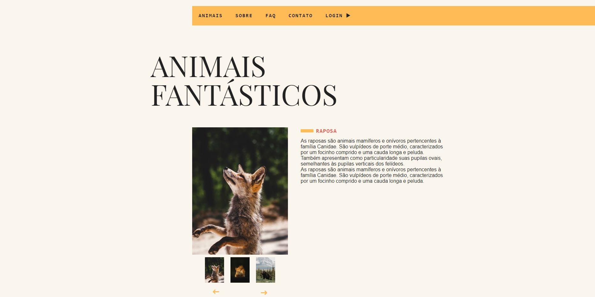

<h1 align="center">🦊 Animais Fantásticos</h1>

  Projeto desenvolvido durante o curso <strong>JavaScript Completo</strong> da Origamid.

  

  
  
  
  
  

---

# 📖 Sobre

O **Animais Fantásticos** é um projeto desenvolvido durante o curso **JavaScript Completo** da Origamid com o objetivo de colocar em prática conceitos fundamentais de JavaScript moderno através da construção de uma interface dinâmica e interativa.

Durante o desenvolvimento foram implementadas diversas funcionalidades utilizando **JavaScript puro**, organizadas em módulos e classes, tornando o projeto uma excelente prática de manipulação do DOM, eventos e programação orientada a objetos.

---

# ✨ Funcionalidades

O projeto conta com diversas funcionalidades desenvolvidas ao longo do curso, entre elas:

- 🖼️ Slide de imagens interativo
- 📱 Menu Mobile
- 📑 Navegação suave (Smooth Scroll)
- 🎯 Navegação por Tab
- ❓ FAQ com Accordion
- 🪟 Modal
- 🖱️ Tooltip
- 🎬 Animações ao Scroll
- ⏱️ Indicador de funcionamento da ONG em tempo real
- 📊 Contador animado de números
- 🌐 Consumo de dados externos utilizando Fetch API
- ⚡ Manipulação do DOM com JavaScript puro
- 📦 Organização do código utilizando ES Modules
- 🏗️ Programação Orientada a Objetos (Classes)

---

# 🚀 Conteúdos praticados

- ✅ HTML5 Semântico
- ✅ CSS3
- ✅ JavaScript ES6+
- ✅ Manipulação do DOM
- ✅ Eventos
- ✅ Classes
- ✅ Modules
- ✅ Fetch API
- ✅ Async / Await
- ✅ Promises
- ✅ Programação Orientada a Objetos
- ✅ Scroll Animations
- ✅ Componentização
- ✅ Organização de código
- ✅ Boas práticas de JavaScript

---

# 🛠 Tecnologias

  
  
  

---

# 🎯 Objetivo

Este projeto teve como objetivo consolidar meus conhecimentos em **JavaScript moderno**, colocando em prática conceitos como manipulação do DOM, modularização do código, orientação a objetos, consumo de APIs e criação de interfaces interativas utilizando HTML, CSS e JavaScript.

---

# 🔗 Links

- 🌐 **Deploy:** https://gustavogularte.github.io/projeto-animais-fantasticos/
- 📚 **Projeto original da Origamid:** https://www.origamid.com/projetos/animais-fantasticos/
- 💼 **LinkedIn:** https://www.linkedin.com/in/gustavo-gularte-arend-58742a286/
- 🌐 **Meu perfil no Frontend Mentor:** https://www.frontendmentor.io/profile/gustavogularte
